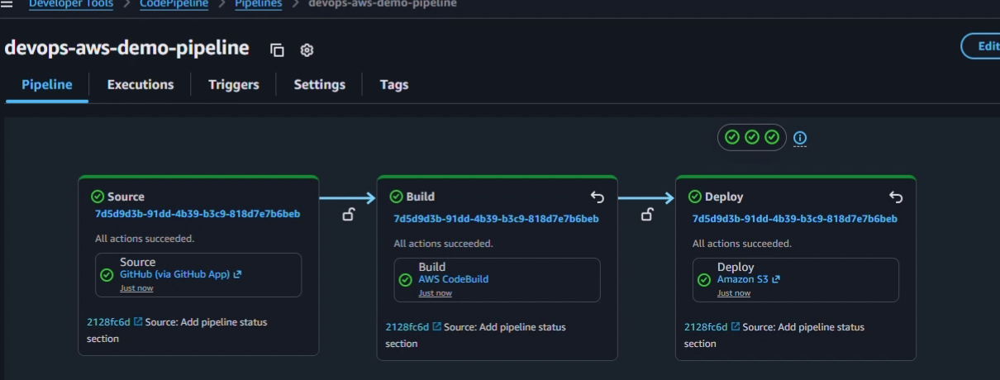
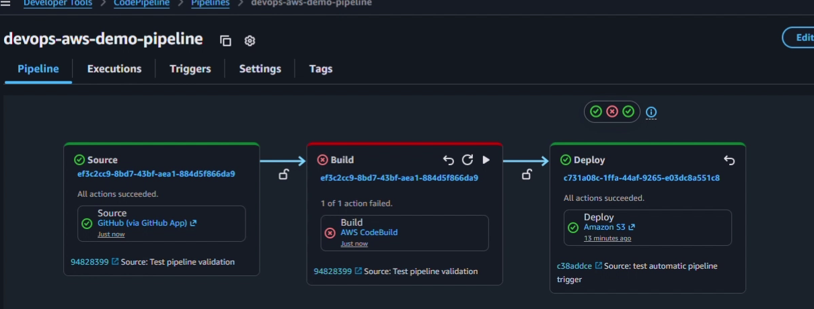
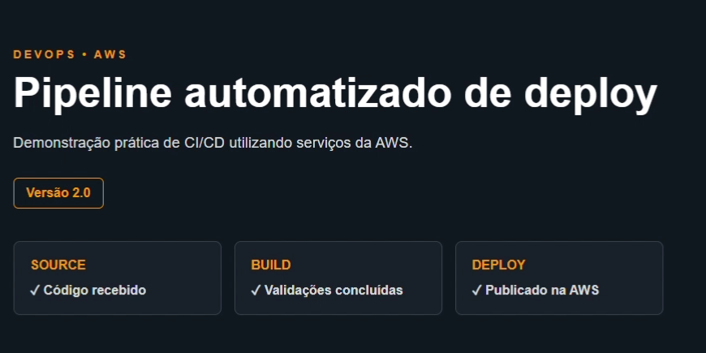

# AWS CI/CD Pipeline — Automated Static Website Deployment

An academic DevOps project developed at **UniCEUB** to demonstrate an automated deployment workflow with **GitHub**, **AWS CodePipeline**, **AWS CodeBuild**, and **Amazon S3**.

The focus is on the **CI/CD workflow**, not on building a complex website: a change pushed to GitHub triggers a pipeline that validates the source files and, if those checks succeed, deploys the static website to S3.

## Pipeline overview

```text
GitHub repository (push)
         |
         v
AWS CodePipeline — Source (GitHub App)
         |
         v
AWS CodeBuild — Build / file validations
         |
         |  Only if validation succeeds
         v
AWS CodePipeline — Deploy (Amazon S3)
         |
         v
Updated static website
```

### Pipeline running successfully



## How it works

1. **Source:** CodePipeline detects a repository update through its GitHub connection and retrieves the latest source code.
2. **Build:** CodeBuild runs the commands declared in [`buildspec.yml`](buildspec.yml). They check that the required HTML and CSS files exist and that the HTML contains the expected `data-app` marker.
3. **Deploy:** If validation succeeds, the files inside `site/` are passed as the build artifact and deployed to an S3 bucket.
4. **Result:** The published static website reflects the successfully deployed version of the repository.

### Build validation

The project uses simple automated *file and content checks*, not a full unit-testing suite. Its `buildspec.yml` validates:

```bash
test -f site/index.html
test -f site/style.css
grep -q 'data-app="aws-devops-demo"' site/index.html
```

The build artifact is configured with `base-directory: site`, so the static website files are the deployment output.

## Demonstrating failure and recovery

The demonstration includes an intentionally unsuccessful validation, showing that an invalid change is stopped at the **Build** stage instead of automatically reaching deployment. In the failure screenshot, the green **Deploy** card still reflects an **earlier successful execution**, not a deployment of the failed change.



After the source was corrected and a new change was pushed, the pipeline completed all three stages successfully, publishing the updated website.

### Deployed website — version 2.0



## Repository structure

```text
devops-aws-demo/
├── site/
│   ├── index.html
│   └── style.css
├── buildspec.yml
├── screenshots/
│   ├── pipeline-success.png
│   ├── pipeline-validation-failed.png
│   └── deployed-website-v2.png
└── README.md
```

## Technologies and concepts

- **Git and GitHub** — version control and the pipeline source
- **AWS CodePipeline** — CI/CD workflow orchestration
- **AWS CodeBuild** — automated validation and artifact preparation
- **Amazon S3** — static file deployment
- **HTML and CSS** — demonstration website
- **CI/CD** — automated validation, deployment, and failure handling

## Project scope

This was a hands-on **academic demonstration**, not a production application. The pipeline and AWS resources were configured in the AWS Console; the repository contains the website source and build specification, **not** an Infrastructure-as-Code template that recreates the cloud environment.

The screenshots document a successful run even if the original AWS resources or public website endpoint are no longer available.
